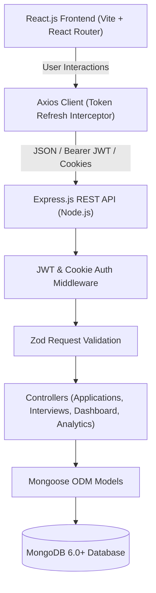

# CareerTrack — Premium Job Application Management System

> **“Your career journey, organized.”**  
> A complete, production-grade, full-stack MERN (MongoDB, Express.js, React.js, Node.js) web application designed for comprehensive tracking of job applications, interview pipelines, company intelligence, and job search analytics.

---

## 1. Table of Contents
- [Project Overview](#project-overview)
- [System Architecture](#system-architecture)
- [Key Features](#key-features)
- [Technology Stack](#technology-stack)
- [Project Directory Structure](#project-directory-structure)
- [MongoDB Database Design](#mongodb-database-design)
- [REST API Endpoint Reference](#rest-api-endpoint-reference)
- [Authentication & Security Design](#authentication--security-design)
- [Environment Configuration](#environment-configuration)
- [Installation & Quick Start](#installation--quick-start)
- [Seeding Demo Data](#seeding-demo-data)
- [Running Automated Tests](#running-automated-tests)
- [Postman API Collection](#postman-api-collection)
- [College Viva & Evaluation Guide](#college-viva--evaluation-guide)

---

## 2. Project Overview

### Problem Statement
Job seekers and software engineers actively applying to dozens of companies often face disorganized spreadsheets, missed interview rounds, lost recruiter contacts, and zero analytics on which application channels actually yield interviews and offers.

### Solution
**CareerTrack** provides a centralized, high-performance web dashboard that unifies application lifecycle management, Kanban pipeline visualization, monthly interview calendaring, company directory management, automated timeline logging, and cohort conversion analytics.

---

## 3. System Architecture

CareerTrack adheres to clean 3-tier architecture with strict boundary separation between client presentation, RESTful business logic, and MongoDB document persistence.



---

## 4. Key Features

1. **Authentication & Session Management**:
   - Secure registration and login with bcryptjs password hashing.
   - JWT access tokens (15m expiry) paired with revocable, rotated refresh tokens (7d expiry) stored in HttpOnly cookies.
   - Automatic silent token refresh via Axios response interceptors.

2. **Dashboard Overview**:
   - 6 dynamic KPI cards: Total, Applied, Assessments, Interviews, Offers, Rejections (derived from real MongoDB records).
   - Recruitment progression pipeline with response rate %, interview yield %, and offer conversion %.
   - Interactive Recharts: Applications Over Time AreaChart and Status Distribution Donut Chart.
   - Latest 5 applications with next interview dates.
   - Upcoming interviews widget with meeting join links.

3. **Application Management**:
   - Complete CRUD operations on job applications.
   - **Dual Views**: Interactive Data Table view with pagination, search, and sorting vs. Kanban Board view with drag/quick-status mover across 7 statuses (`Wishlist`, `Applied`, `Assessment`, `Interview`, `Offer`, `Rejected`, `Withdrawn`).
   - Deep search (company, role, location, tags) with multi-criteria filtering (status, priority, work arrangement, source).
   - **RFC-4180 CSV Export**: One-click download of all filtered applications to CSV.

4. **Application Details View**:
   - Comprehensive position overview, salary ranges, and recruiter contacts.
   - Scheduled interview rounds list with quick outcome updates (Pending, Passed, Failed, Cancelled).
   - Chronological activity timeline recording all state changes (`APPLICATION_CREATED`, `STATUS_CHANGED`, `INTERVIEW_SCHEDULED`, etc.).

5. **Interview Calendar & Management**:
   - Full monthly interactive calendar view with date highlighting and interview count badges.
   - Modal for scheduling rounds with preparation checklist items, durations, interviewers, and meeting links.
   - Upcoming interview timeline widget alongside calendar.

6. **Company Intelligence Directory**:
   - Directory of target organizations with industry, headquarters, websites, and research notes.
   - Auto-computed application count per company.
   - Modal to inspect all applications linked to each company.

7. **Search & Pipeline Analytics**:
   - Conversion cohorts with date range filtering (Last 30 Days, 90 Days, This Year, All Time).
   - Source effectiveness yield analysis (LinkedIn vs Referral vs Company Website).
   - Monthly offers vs rejections comparison.
   - Average days from application submission to first scheduled interview.

8. **Settings & Customization**:
   - User profile customization.
   - Workspace defaults (Default View: Table/Kanban, Preferred Currency, Timezone, Date Format).
   - Secure password update workflow.

---

## 5. Technology Stack

### Frontend
- **Framework**: React.js 18.3 with Vite 5.2
- **Language**: JavaScript (ES6+ Modules)
- **Styling**: Bootstrap 5.3 + Custom CSS Design System (`client/src/index.css`)
- **Animations**: Framer Motion 11.2
- **Data Visualization**: Recharts 2.12
- **Icons**: Lucide React
- **Forms**: React Hook Form with Zod validation
- **Notifications**: React Hot Toast
- **Dates**: date-fns

### Backend
- **Runtime**: Node.js v20+
- **Framework**: Express.js 4.19
- **Database**: MongoDB with Mongoose 8.4 ODM
- **Authentication**: JSON Web Tokens (`jsonwebtoken`), `bcryptjs`, `cookie-parser`
- **Validation**: Zod 3.23
- **Security**: Helmet, CORS, Express Rate Limit (`express-rate-limit`)
- **Logging**: Morgan

### Testing & QA
- **Backend Tests**: Jest 29 + Supertest 7
- **API Tooling**: Postman Collection (v2.1) + Environment File

---

## 6. Project Directory Structure

```text
careertrack/
├── client/                     # React Frontend
│   ├── public/
│   ├── src/
│   │   ├── api/                # Axios instance & API client modules
│   │   ├── components/         # Reusable presentation & layout components
│   │   │   ├── applications/   # Application form modal & cards
│   │   │   ├── common/         # StatCard, StatusBadge, PriorityBadge, Modals
│   │   │   ├── companies/      # Company modals & cards
│   │   │   ├── interviews/     # Interview modal & checklist
│   │   │   └── layout/         # AppShell, Navbar, Sidebar
│   │   ├── context/            # AuthContext & NotificationContext
│   │   ├── pages/              # Route pages (Dashboard, Applications, Details, etc.)
│   │   ├── routes/             # ProtectedRoute & AppRoutes
│   │   ├── utils/              # Constants & formatters
│   │   ├── App.jsx             # Root React component
│   │   ├── index.css           # Global design system & tokens
│   │   └── main.jsx            # React DOM mounting
│   ├── index.html
│   ├── vite.config.js
│   └── package.json
├── server/                     # Node.js + Express Backend
│   ├── src/
│   │   ├── config/             # MongoDB connection & config loader
│   │   ├── controllers/        # Express route handler logic
│   │   ├── middleware/         # Auth, validation, error handler, notFound
│   │   ├── models/             # Mongoose schemas (User, Application, Interview, etc.)
│   │   ├── routes/             # REST API routers
│   │   ├── scripts/            # Database seed script (seed.js)
│   │   ├── services/           # Activity logging, notifications, CSV generator
│   │   ├── utils/              # Standard JSON response helpers & JWT tokens
│   │   ├── validators/         # Zod schemas for request validation
│   │   ├── app.js              # Express app initialization
│   │   └── server.js           # Server listen & graceful shutdown
│   ├── tests/                  # Jest + Supertest test suites
│   ├── .env.example
│   └── package.json
├── postman/                    # Postman Collection & Environment
│   ├── careertrack.postman_collection.json
│   └── careertrack.postman_environment.json
├── package.json                # Root orchestration scripts
└── README.md
```

---

## 7. MongoDB Database Design

The database utilizes 7 normalized Mongoose collections:

1. **User**: Name, unique normalized email, hashed password, preferences (theme, defaultView, currency, timeZone, dateFormat).
2. **RefreshToken**: Revocable session store supporting token rotation with TTL index.
3. **Application**: Company name, foreign key to Company, job title, description, URLs, work arrangement, employment type, salary range, source, application date, status enum, priority enum, recruiter details, notes, tags.
4. **Interview**: Foreign keys to User and Application, round name, interview type, scheduled date, duration, mode (Online/Phone/In Person), meeting link, interviewers, preparation checklist, outcome, and feedback.
5. **Company**: Company directory with unique compound index `{ userId: 1, name: 1 }`, website, industry, location, and research notes.
6. **Activity**: Chronological event timeline records (`APPLICATION_CREATED`, `STATUS_CHANGED`, `INTERVIEW_SCHEDULED`, etc.).
7. **Notification**: In-app notifications with unread tracking, timestamps, and application associations.

---

## 8. REST API Endpoint Reference

All endpoints return uniform JSON responses:
- Single resource: `{ success: true, message: "...", data: { ... } }`
- Paginated list: `{ success: true, message: "...", data: [ ... ], pagination: { page, limit, total, totalPages } }`
- Error: `{ success: false, message: "...", errors: [ ... ] }`

### Authentication (`/api/auth`)
| Method | Endpoint | Description | Auth Required |
|---|---|---|---|
| `POST` | `/api/auth/register` | Register new user account | No |
| `POST` | `/api/auth/login` | Authenticate user & issue tokens | No |
| `POST` | `/api/auth/refresh` | Rotate and issue new access token | No (Cookie) |
| `POST` | `/api/auth/logout` | Revoke session and clear cookies | Yes |
| `GET` | `/api/auth/me` | Fetch authenticated user profile | Yes |
| `PATCH` | `/api/auth/me` | Update name and preferences | Yes |
| `PATCH` | `/api/auth/change-password` | Verify current & update password | Yes |

### Dashboard (`/api/dashboard`)
| Method | Endpoint | Description | Auth Required |
|---|---|---|---|
| `GET` | `/api/dashboard/summary` | Summary KPIs and recruitment funnel | Yes |
| `GET` | `/api/dashboard/recent-applications`| Latest 5 applications with next interview | Yes |
| `GET` | `/api/dashboard/upcoming-interviews`| Upcoming pending interviews | Yes |
| `GET` | `/api/dashboard/application-trends` | Monthly submission volume | Yes |
| `GET` | `/api/dashboard/status-distribution`| Application counts by status | Yes |
| `GET` | `/api/dashboard/source-distribution`| Application counts by source | Yes |

### Applications (`/api/applications`)
| Method | Endpoint | Description | Auth Required |
|---|---|---|---|
| `POST` | `/api/applications` | Create new application & log activity | Yes |
| `GET` | `/api/applications` | List with search, multi-filter, sort, page | Yes |
| `GET` | `/api/applications/stats` | Status count statistics | Yes |
| `GET` | `/api/applications/export`| Download RFC-4180 CSV export | Yes |
| `GET` | `/api/applications/:id` | Fetch application, interviews & timeline | Yes |
| `PUT` | `/api/applications/:id` | Update application details | Yes |
| `PATCH`| `/api/applications/:id/status`| Transition status & record history | Yes |
| `DELETE`| `/api/applications/:id`| Cascade delete app and linked records | Yes |

### Interviews (`/api/interviews`)
| Method | Endpoint | Description | Auth Required |
|---|---|---|---|
| `POST` | `/api/interviews` | Schedule interview & auto-advance status | Yes |
| `GET` | `/api/interviews` | List interviews with filters | Yes |
| `GET` | `/api/interviews/upcoming` | Next 10 scheduled interviews | Yes |
| `GET` | `/api/interviews/calendar` | Fetch interviews for selected month | Yes |
| `GET` | `/api/interviews/:id` | Get interview details | Yes |
| `PUT` | `/api/interviews/:id` | Update interview details | Yes |
| `PATCH`| `/api/interviews/:id/outcome` | Update outcome (Passed/Failed) | Yes |
| `DELETE`| `/api/interviews/:id` | Delete interview record | Yes |

### Companies (`/api/companies`)
| Method | Endpoint | Description | Auth Required |
|---|---|---|---|
| `POST` | `/api/companies` | Create new company profile | Yes |
| `GET` | `/api/companies` | List companies with application count | Yes |
| `GET` | `/api/companies/:id` | Get company details | Yes |
| `PUT` | `/api/companies/:id` | Update company information | Yes |
| `DELETE`| `/api/companies/:id` | Delete company (safely unsets app refs) | Yes |
| `GET` | `/api/companies/:id/applications` | Fetch all applications for company | Yes |

### Analytics (`/api/analytics`)
| Method | Endpoint | Description | Auth Required |
|---|---|---|---|
| `GET` | `/api/analytics/overview` | Conversion cohort overview | Yes |
| `GET` | `/api/analytics/application-trends` | Timeline trends with date filter | Yes |
| `GET` | `/api/analytics/status-distribution`| Status distribution with date filter | Yes |
| `GET` | `/api/analytics/source-effectiveness` | Yield and conversion rate by source | Yes |
| `GET` | `/api/analytics/interview-performance`| Interviews by type and outcome | Yes |
| `GET` | `/api/analytics/monthly-outcomes` | Monthly offers vs rejections | Yes |

### Activities & Notifications & Health
| Method | Endpoint | Description | Auth Required |
|---|---|---|---|
| `GET` | `/api/activities/recent` | Recent timeline entries across all apps | Yes |
| `GET` | `/api/applications/:id/activities` | Chronological activity timeline | Yes |
| `GET` | `/api/notifications` | User notifications list | Yes |
| `GET` | `/api/notifications/unread-count` | Count of unread notifications | Yes |
| `PATCH`| `/api/notifications/:id/read` | Mark notification as read | Yes |
| `PATCH`| `/api/notifications/read-all` | Mark all notifications as read | Yes |
| `DELETE`| `/api/notifications/:id` | Delete notification | Yes |
| `GET` | `/api/health` | Health check (uptime, mongo state) | No |

---

## 9. Authentication & Security Design

1. **Password Protection**:
   - Salting and hashing via `bcryptjs` with work factor 12. Passwords are never stored or returned in plain text.
2. **JWT Architecture & Token Rotation**:
   - Short-lived Access Tokens (15 min) for authorized requests.
   - Long-lived Refresh Tokens (7 days) saved as SHA-256 hashes in MongoDB with rotation upon use.
   - Storage in `HttpOnly`, `SameSite: Lax` cookies preventing XSS token theft.
3. **Strict Resource Ownership & Isolation**:
   - Every database query in protected controllers matches `{ userId: req.user.id }`.
   - Modifying or accessing another user's ID yields a 404/403.
4. **Injection & Rate Limiting**:
   - Rate limiting on authentication routes (100 requests per 15 minutes) to deter brute-force attacks.
   - HTTP Security headers configured via `Helmet`.
   - Zod request body validation catching malformed payloads before execution.

---

## 10. Environment Configuration

### Server Configuration (`server/.env`)
```ini
PORT=5001
NODE_ENV=development
MONGODB_URI=mongodb://127.0.0.1:27017/careertrack
CLIENT_URL=http://localhost:5173
JWT_ACCESS_SECRET=careertrack_super_secret_access_jwt_key_2026_dev_secure
JWT_REFRESH_SECRET=careertrack_super_secret_refresh_jwt_key_2026_dev_secure
ACCESS_TOKEN_TTL=15m
REFRESH_TOKEN_TTL=7d
```

### Client Configuration (`client/.env`)
```ini
VITE_API_URL=http://localhost:5001/api
```

---

## 11. Installation & Quick Start

### Prerequisites
- Node.js (v18 or v20+)
- MongoDB (running locally or MongoDB Atlas)

### Step 1: Install Dependencies
From the project root:
```bash
npm run install:all
```
*(Alternatively: `cd server && npm install && cd ../client && npm install`)*

### Step 2: Seed the Database
Populate realistic demo job applications, interviews, and company data:
```bash
npm run seed
```

### Step 3: Run Both Servers Simultaneously
```bash
npm run dev
```
- Frontend starts at: **http://localhost:5173**
- Backend starts at: **http://localhost:5001**
- API Health check: **http://localhost:5001/api/health**

---

## 12. Seeding Demo Data

CareerTrack comes with an automated seed script (`server/src/scripts/seed.js`).

To run:
```bash
cd server
npm run seed
```

### Demo User Credentials:
- **Email**: `demo@careertrack.dev`
- **Password**: `Password123!`

The seed script creates:
- 1 Demo User (`Alex Morgan`)
- 8 Tech Companies (Stripe, Google, Figma, Spotify, Airbnb, Datadog, Netflix, Microsoft)
- 10 Realistic Applications across diverse statuses (`Wishlist`, `Applied`, `Assessment`, `Interview`, `Offer`, `Rejected`, `Withdrawn`)
- Multiple scheduled, passed, and upcoming interview rounds with checklists
- In-app notification alerts and chronological activity timeline entries

---

## 13. Running Automated Tests

A comprehensive suite of backend integration tests using **Jest** and **Supertest** verifies health checks, authentication, application CRUD, status transitions, interview scheduling, cross-user security isolation, and cascade deletions.

Run the tests with:
```bash
npm test
```
*(Or inside server: `cd server && npm test`)*

**Test Result Summary**:
```text
PASS tests/api.test.js
  CareerTrack API Test Suite
    Health API
      ✓ GET /api/health returns 200 and healthy status
    Authentication APIs
      ✓ POST /api/auth/register registers a new user
      ✓ POST /api/auth/register rejects duplicate email
      ✓ POST /api/auth/login logs in with valid credentials
      ✓ POST /api/auth/login rejects invalid password
      ✓ GET /api/auth/me returns authenticated user profile
      ✓ Register a second user for cross-user security isolation testing
    Application APIs & Authorization Security
      ✓ POST /api/applications creates an application for user 1
      ✓ GET /api/applications returns user 1 applications with pagination
      ✓ GET /api/applications/:id returns application details
      ✓ SECURITY: User 2 CANNOT access User 1 application
      ✓ PATCH /api/applications/:id/status updates status and creates timeline activity
      ✓ GET /api/applications/stats returns status distribution stats
      ✓ GET /api/applications/export returns RFC CSV download
    Interview APIs & Cross-User Protection
      ✓ POST /api/interviews schedules an interview for user 1
      ✓ SECURITY: User 2 cannot schedule an interview on User 1 application
      ✓ PATCH /api/interviews/:id/outcome records outcome and feedback
      ✓ GET /api/interviews/calendar returns calendar events
    Dashboard & Analytics APIs
      ✓ GET /api/dashboard/summary returns dynamic metrics
      ✓ GET /api/analytics/overview returns computed cohorts
      ✓ GET /api/analytics/source-effectiveness returns source performance
    Application Deletion & Cascading Clean-up
      ✓ DELETE /api/applications/:id deletes application and its interviews

Test Suites: 1 passed, 1 total
Tests:       22 passed, 22 total
```

---

## 14. Postman API Collection

A complete Postman collection and environment file is included in the `postman/` directory:
- `postman/careertrack.postman_collection.json`
- `postman/careertrack.postman_environment.json`

### How to Import & Use in Postman:
1. Open Postman -> Click **Import** -> Select both files in the `postman/` folder.
2. Select the **CareerTrack Local Environment**.
3. Send the request under `2. Authentication > Login User`.
4. The test script will **automatically store the JWT `accessToken`** into the environment, allowing you to run all protected endpoints seamlessly!

---

## 15. College Viva & Evaluation Guide

Frequently asked viva questions and practical examination talking points:

### Q1: How is user authorization enforced across requests?
**Answer**: In `server/src/middleware/authenticate.js`, the incoming JWT access token is verified using HMAC-SHA256. Upon verification, the user ID is extracted and attached to `req.user`. Every controller query explicitly filters by `{ userId: req.user.id }`. Even if a user knows another user's MongoDB ObjectId, the server will return a 404/403 rather than unauthorized data.

### Q2: Why use both Access Tokens and Refresh Tokens?
**Answer**: Access tokens have a short lifespan (15 minutes). If intercepted, the exposure window is minimal. Refresh tokens (7 days) are stored in secure `HttpOnly` cookies that JavaScript cannot access (mitigating XSS). When the access token expires, the Axios response interceptor automatically calls `/api/auth/refresh`, rotates the refresh token in MongoDB, and retries the failed request seamlessly without logging the user out.

### Q3: How are dashboard statistics and charts calculated?
**Answer**: All dashboard statistics and charts are dynamically aggregated from MongoDB using Mongoose aggregation pipelines (`$match`, `$group`, `$sum`, `$project`). No statistics are hardcoded.

### Q4: How is state managed on the React frontend?
**Answer**: Shared global states (current user profile and in-app notifications) are managed via React Context (`AuthContext` and `NotificationContext`). Page-level states (such as application filters, modal forms, and pagination) use standard React hooks (`useState`, `useEffect`, `useCallback`) to preserve fast rendering and minimal unnecessary component re-renders.

### Q5: How is data consistency preserved when deleting records?
**Answer**: In `server/src/controllers/application.controller.js`, deleting an application triggers cascade cleanup of associated records:
`Interview.deleteMany({ applicationId })`, `Activity.deleteMany({ applicationId })`, and `Notification.deleteMany({ applicationId })`, preventing orphan references.

---

## 16. License & Authors
- **Project**: CareerTrack — Job Application Management System
- **Stack**: Full MERN (MongoDB, Express, React, Node.js)
- **Status**: Complete, Tested, Production Quality.
